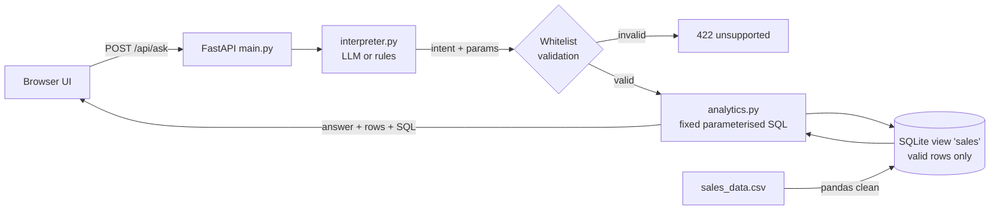

# Mini AI Business Intelligence Assistant

Ask natural-language questions about sales data; get an answer, the supporting figures, and the SQL used.

## Setup & run
```bash
pip install -r requirements.txt
uvicorn app.main:app --reload        # open http://127.0.0.1:8000
pytest -q                            # 11 tests
```
Optional LLM routing: `export ANTHROPIC_API_KEY=...` (model via `LLM_MODEL`, default `claude-haiku-4-5`).
Without a key, a rule-based interpreter is used automatically.

## Architecture

Plain-text flow: UI -> /api/ask -> interpreter (LLM or rules) -> whitelist check -> fixed SQL on SQLite -> answer, supporting table and SQL back to the UI.

- **app/db.py** – loads CSV with pandas, cleans it, writes SQLite (in-memory, rebuilt on start).
- **app/interpreter.py** – picks an intent. The LLM never writes SQL.
- **app/analytics.py** – one fixed SQL query per intent.
- **app/main.py** – FastAPI endpoints, input validation, error handling.
- **static/index.html** – single-page UI.

## Data storage & cleaning
All 51 rows go into `sales_raw` with `is_valid` and `invalid_reason` columns (nothing silently dropped).
View `sales` = valid rows + `revenue = Quantity * Unit_price - Discount_amount`. Dates are parsed as DD-MM-YYYY.
Excluded rows: **TXN0033** (status Returned), **TXN0034** (quantity 0), **TXN0051** (missing unit price).
These exclusions are shown in the UI with every answer.

## Supported questions
Total revenue · top product · top region · top category · monthly trend · compare two months (all 5 example questions).

## How wrong/unsafe answers are prevented
- **No text-to-SQL**: the LLM only chooses from 6 whitelisted intents (+ month params), so destructive or invented queries cannot be produced. The SQLite view is also the only thing queried.
- LLM output is validated; unknown intents/params are dropped, and failures fall back to rules.
- Unsupported questions return a clear 422 listing what is supported; months with no data return an error rather than a guess.
- Every answer shows the figures and SQL behind it.

## Known limitations
- Keyword fallback is brittle for unusual phrasings (the LLM path handles these better).
- Year is fixed to 2026; no filters (e.g. "revenue of Monitor in North").
- Returned orders are excluded entirely rather than netted as refunds (assumption – revenue = completed sales only).
- Compare uses the order the months appear in the question.
- In-memory DB; no auth, rate limiting or pagination.
